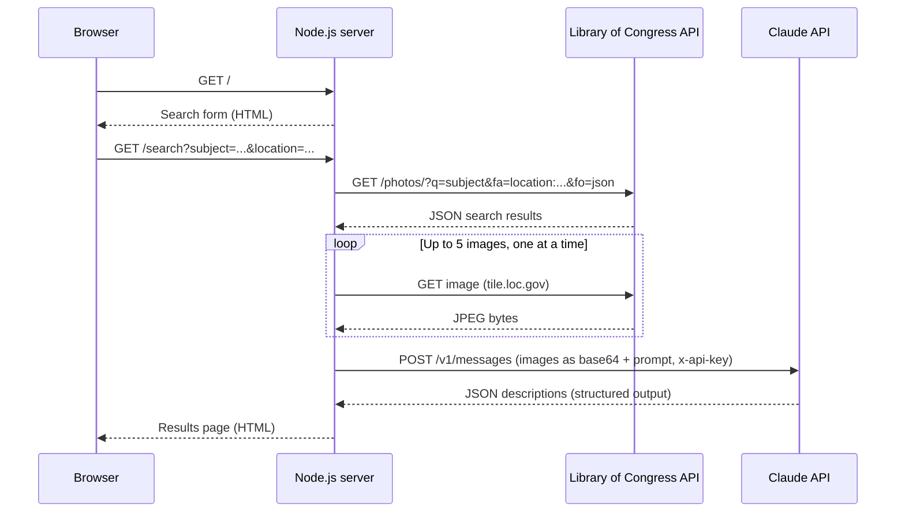

# Historic Photo Explorer

A Node.js web app that makes historical photographs accessible to blind and visually impaired readers.
You enter a subject and a location. The server searches the **Library of Congress** photo archive,
downloads the matching images, and sends them to the **Claude API**, which writes a detailed description of
each photo. The results page shows each image next to its description, estimated time period and notable details.

Built with **zero third-party dependencies**: only Node.js core modules (`http`, `https`, `fs`) and
callback-style asynchronous code. No Express, no SDKs, no `fetch`.

## How it works



Each request waits for the previous one to finish, so the steps always run in order: search, download, describe.
Finished results are cached in memory for one hour, so repeating a search doesn't call the APIs again.

## APIs used

| API | Auth | Purpose |
| --- | --- | --- |
| [Library of Congress JSON API](https://www.loc.gov/apis/json-and-yaml/) | None (public) | Search the photo archive and download images |
| [Claude Messages API](https://platform.claude.com/docs/en/api/messages) | API key | Describe each image for visually impaired readers |

The Claude request uses **structured outputs** (a JSON schema), so the response always has the same shape.
The server then renders the HTML itself and escapes everything, instead of trusting model-generated markup.

## Getting started

**Requirements:** Node.js 20.12 or newer and an [Anthropic API key](https://platform.claude.com/settings/keys).

```bash
git clone https://github.com/DonYuen231/historic-photo-explorer.git
cd historic-photo-explorer
cp .env.example .env      # then add your ANTHROPIC_API_KEY
npm start
```

Open http://localhost:3000. No `npm install` is needed because there are no dependencies.

### Configuration

Settings are read from environment variables or a `.env` file:

| Variable | Default | Description |
| --- | --- | --- |
| `ANTHROPIC_API_KEY` | (required) | Your Claude API key |
| `PORT` | `3000` | Port to listen on |
| `HOST` | `localhost` | Interface to bind to |
| `CLAUDE_MODEL` | `claude-opus-5-5` | Claude model used for descriptions |
| `MAX_PHOTOS` | `5` | Number of photos described per search |

## Project structure

```
├── index.js            # Entry point: checks config and starts the server
├── src/
│   ├── config.js       # Environment variables and defaults
│   ├── server.js       # Routing, input validation, request pipeline
│   ├── loc.js          # Library of Congress search and image download
│   ├── claude.js       # Claude API request and response parsing
│   ├── http-client.js  # HTTPS helpers (redirects, timeouts, errors)
│   ├── cache.js        # In-memory cache with expiry
│   └── views.js        # HTML rendering with escaping
├── public/             # Static search page and stylesheet
├── eval/               # Description quality evaluation (see "Evaluation")
└── test/               # Unit tests (node:test)
```

## Testing

```bash
npm test
```

Runs the unit tests with Node's built-in test runner. They don't make network calls.

## Evaluation

Unit tests check the code. They can't tell me whether the descriptions are any good, so I scored them against a rubric, changed the app based on what I found, and scored again.

### Method

I picked 20 Library of Congress photos as 4 searches of 5: portraits (easy), signs with text (medium), crowds and news photos (hard), and bird's-eye prints and maps (hard). `node eval/run.js <version>` sends each group through the app's own download and Claude steps (same prompt, same model, same 5-photo batches). Every photo was chosen because a LoC cataloger had written a summary of what it shows ("Photograph shows…"). That summary is never sent to Claude, so I could use it as a human reference. Each description was scored 1 to 5 on:

- **Accuracy:** is everything it says actually in the photo or the catalog record? A hedged guess that names an event the record contradicts still counts as an error.
- **Completeness:** does it leave out anything important that's in the picture, such as a person, an animal, the main object or a sign? A small thumbnail doesn't excuse a miss, because the listener misses it either way.
- **Usefulness to a blind reader:** how it's told, not what's in it. Read aloud once, can a listener follow it? Main subject first, visible text read out early, no filler, not too long.
- **Matches reference:** how much of the cataloger's summary does it also convey? Wrong reference facts are ignored (in photo 3 the cataloger wrote "purse", but it's a wicker basket, and the model got it right).

Every level from 1 to 5 is defined in **[eval/RUBRIC.md](eval/RUBRIC.md)**, with an example from this eval for each. An earlier three-score version of the rubric, and the scores made with it, are kept in [eval/archive/three-score-rubric/](eval/archive/three-score-rubric/).

Scores were checked by several models and then by a person. Claude drafted them. A panel of four other models graded the same descriptions independently (see [Model judges](#model-judges)). A person then checked the scores against the images, starting with every score where the panel and the draft differed by 2 or more points. These 40 checked scores are the baseline used to measure the model judges ([review sheets](eval/), [v1 scores](eval/scores-v1.csv), [v2 scores](eval/scores-v2.csv)). Model: `claude-opus-5-5`, November 2026.

### Round 1 (v1): what I found

1. **Image size mattered more than how hard the photo was.** For 5 of the 20 photos, LoC only offers a 150-pixel thumbnail, and the app sent it anyway. Those 5 averaged 3.2 for accuracy, against 4.8 for the rest, and they included every serious mistake. On photo 14 the model said a stretcher carried "presumably the victim"; the record says it was the gang's lawyer. The model said the image was too small in only 2 of the 5 cases.
2. **It filled gaps with plausible history.** It linked a 1966 burning squad car to "the July 1966 West Side unrest", but the record says it was a gang fight on the northwest side. On two photos it replaced the catalog date with its own guess, without any visible evidence.
3. **It read text in images very well, but didn't always put it first.** All four signs were transcribed correctly, down to an artist's signature and a tiny sticker. On the dense prints, though, the title and banner text only appeared at the end of the "notable details" list.

### Changes (v2)

- **Low-resolution check** ([src/image-size.js](src/image-size.js), [src/loc.js](src/loc.js)): the app reads each image's width and height from its bytes. If the longest side is under 400px, the photo is marked low resolution. Claude is told so in the prompt, and the results page shows a notice next to the photo.
- **Stricter prompt** ([src/claude.js](src/claude.js)): it now says to start with the main subject and any text written on the image; to name people, places or events only when the catalog title or visible text supports it; to use the catalog date unless something visible clearly contradicts it; and, for low-resolution photos, to describe less and say why.

### Round 2 (v2): results

Same 20 photos, same model, same scoring. Each cell is v1 → v2.

<details>
<summary>Scores for all 20 photos</summary>

| # | Group | Photo | Accuracy (v1 → v2) | Completeness (v1 → v2) | Usefulness (v1 → v2) | Matches reference (v1 → v2) |
| --- | --- | --- | --- | --- | --- | --- |
| 1 | A | Harriet Tubman standing portrait | 4 → 5 | 5 → 5 | 4 → 4 | 5 → 5 |
| 2 | A | Woman with pearls and gloves | 5 → 5 | 5 → 5 | 4 → 4 | 5 → 5 |
| 3 | A | Woman holding a newspaper | 5 → 5 | 5 → 5 | 4 → 4 | 5 → 5 |
| 4 | A | Family portrait NYC *(150px)* | 3 → 4 | 2 → 2 | 4 → 4 | 3 → 3 |
| 5 | A | Two men on the sidewalk | 5 → 5 | 5 → 5 | 4 → 4 | 5 → 5 |
| 6 | B | Bloom Jeweler neon clock sign | 5 → 5 | 4 → 4 | 5 → 5 | 4 → 4 |
| 7 | B | Castle Clinton sign | 5 → 5 | 5 → 5 | 5 → 5 | 5 → 5 |
| 8 | B | Rancho Luna social club mural | 5 → 5 | 5 → 5 | 5 → 5 | 5 → 5 |
| 9 | B | Cuchifrito No. 1 Bar B.Q. sign | 5 → 5 | 5 → 5 | 5 → 5 | 5 → 5 |
| 10 | B | Muhammad Ali signing autographs *(150px)* | 5 → 5 | 4 → 3 | 4 → 4 | 2 → 2 |
| 11 | C | Communist parade in Chicago | 4 → 5 | 5 → 5 | 4 → 4 | 4 → 4 |
| 12 | C | Oak Street Beach crowd | 5 → 5 | 5 → 5 | 5 → 4 | 5 → 4 |
| 13 | C | American Derby 1904 panorama | 5 → 5 | 5 → 5 | 4 → 5 | 5 → 5 |
| 14 | C | Paddy Murray shooting (two photos) *(150px)* | 2 → 5 | 2 → 2 | 4 → 4 | 1 → 2 |
| 15 | C | Squad car set afire 1966 *(150px)* | 2 → 5 | 3 → 3 | 5 → 4 | 3 → 3 |
| 16 | D | Bird's-eye view of Philadelphia 1872 | 5 → 5 | 5 → 5 | 4 → 5 | 4 → 4 |
| 17 | D | Ruins of Pittsburgh after the 1845 fire | 5 → 5 | 5 → 5 | 5 → 5 | 5 → 4 |
| 18 | D | Diamond Street from above *(150px)* | 4 → 5 | 5 → 5 | 4 → 4 | 4 → 4 |
| 19 | D | Chestnut Street Philadelphia | 4 → 5 | 4 → 4 | 4 → 4 | 4 → 4 |
| 20 | D | Topographic view of Reading 1881 | 5 → 5 | 4 → 4 | 3 → 4 | 4 → 4 |

Notes on each score are in [eval/scores-v1.csv](eval/scores-v1.csv) and [eval/scores-v2.csv](eval/scores-v2.csv). Regenerate these tables with `node eval/summarize.js v1 v2`.
</details>

| Subset | Photos | Accuracy (v1 → v2) | Completeness (v1 → v2) | Usefulness (v1 → v2) | Matches reference (v1 → v2) |
| --- | --- | --- | --- | --- | --- |
| **All** | 20 | 4.40 → 4.95 | 4.40 → 4.35 | 4.30 → 4.35 | 4.15 → 4.10 |
| Easy (group A) | 5 | 4.40 → 4.80 | 4.40 → 4.40 | 4.00 → 4.00 | 4.60 → 4.60 |
| Hard (groups C, D) | 10 | 4.10 → 5.00 | 4.30 → 4.30 | 4.20 → 4.30 | 3.90 → 3.80 |
| Full-size image | 15 | 4.80 → 5.00 | 4.80 → 4.80 | 4.33 → 4.47 | 4.67 → 4.53 |
| 150px thumbnail only | 5 | 3.20 → 4.80 | 3.20 → 3.00 | 4.20 → 4.00 | 2.60 → 2.80 |

1. **Accuracy went up the most where it was worst.** On the 5 thumbnails it went from 3.2 to 4.8. All 5 were flagged correctly. The model stopped guessing (no more "the victim", no invented riot, no "late-1920s automobiles") and said what it couldn't see. On full-size images every description scored 5 for accuracy.
2. **Completeness and matching the reference didn't improve (4.40 → 4.35 and 4.15 → 4.10).** On the thumbnails, completeness stayed around 3. Being careful stops the model from making things up, but it can't make a 150px image show Muhammad Ali, a second police car or two dogs. That limit is in the source data, not the prompt.
3. **The stricter prompt had costs.** It removed some correct context: the Pittsburgh print no longer says the ruins came from a fire, and the Bloom Jeweler sign lost its diamond-ring hint. It also added filler: many descriptions now start with "no text is visible on the image" or "identified by the catalog title", which a screen-reader user has to sit through.

### Model judges

To cross-check the scores and compare Claude with other vision models, four models on NanoGPT (DeepSeek V4.1 Flash, Kimi K2.6, Gemma 4 31B and Muse Spark 1.3) each:

1. wrote their own descriptions of the same 20 photos, using the app's v2 prompt, and
2. graded all six sets (Claude v1, Claude v2 and the four models' own) with the same rubric, blind to who wrote them. The judges saw the photo, catalog record, reference summary and rubric, but not the rubric's examples.

`node eval/judge.js` runs both steps (resumable); `node eval/compare.js` writes [eval/judges/summary.md](eval/judges/summary.md). Each model's grades of its own descriptions are left out of the ranking.

| Descriptions by | Accuracy | Completeness | Usefulness | Matches reference | Overall |
| --- | --- | --- | --- | --- | --- |
| **Claude v1** | 4.59 | 4.19 | 4.41 | 4.00 | **4.30** |
| **Claude v2** | 4.75 | 4.11 | 4.42 | 3.80 | **4.27** |
| DeepSeek V4.1 Flash | 4.83 | 3.77 | 4.60 | 3.38 | 4.15 |
| Muse Spark 1.3 | 4.37 | 4.07 | 4.35 | 3.77 | 4.14 |
| Kimi K2.6 | 4.47 | 3.78 | 4.72 | 3.57 | 4.13 |
| Gemma 4 31B | 4.45 | 3.30 | 4.62 | 3.50 | 3.97 |

1. **Claude ranks first because it covers more**, not because it's more accurate: DeepSeek is the most accurate, and Kimi's are the easiest to listen to. The other models write shorter descriptions that leave more out.
2. **The judges agree with the checked baseline.** The panel's median score is within 1 point of the baseline on 95–100% of descriptions, with no overall bias. Kimi is the strictest judge, scoring about 0.4 below the baseline on average.
3. **Judges mostly don't favor their own work.** Gemma is the exception, scoring its own descriptions about 0.4 higher than the other judges do.
4. **Judges miss errors hidden in the "notable details" list.** On the squad car (v1), only one of four judges caught the wrong event guess, which sits at the end of that list. Most judges seem to grade the main description and skim the rest.

### What I'd change next

- **Only mention text when there is some.** Add "If there's no text on the image, don't say so" to the prompt, to remove the filler.
- **Allow well-known context from the title.** Let the model explain an event the title clearly refers to (a print titled "ruins of Pittsburgh" can mention the 1845 fire), while still not linking a photo to an event the title doesn't mention.
- **Make further checking fully model-based.** Having a person check every score doesn't scale past a few dozen photos, so new photos will be scored by the judge panel alone. The 40 checked scores become a calibration set. When the prompt, rubric or judge models change, re-run the panel on that set, and trust its scores only while its median stays within 1 point of the baseline. The judges' prompt should also tell them to check the notable-details list, where they missed an error.
- **Test identification more directly.** Add photos where the main subject is a person the reference names.

## Error handling

- Missing or overly long input returns **400** with a friendly message. Unknown routes return **404**.
- Every outbound request has a timeout. Redirects are followed, with a limit.
- If an image fails to download it is skipped, and the remaining photos are still described.
- If an upstream API fails, the user sees a **502** page. The details are logged on the server.

## Background

This started as the final project for CS 355 at CUNY.
The assignment was to build a mashup of two APIs using only Node.js core modules, with the requests
running one after another. It was later refactored into the current structure.

## License

[MIT](LICENSE)
