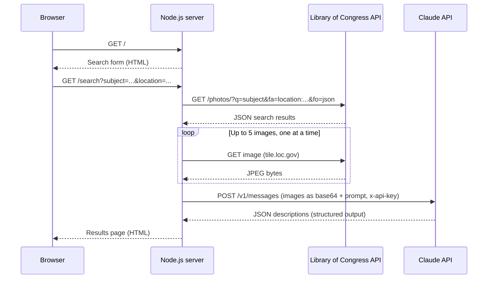

# Historic Photo Explorer

A Node.js web app that makes historical photographs accessible to blind and visually impaired readers.
You enter a subject and a location. The server searches the **Library of Congress** photo archive,
downloads the matching images, and sends them to the **Claude API**, which writes a detailed description of
each photo. The results page shows each image next to its description, estimated time period and notable details.

Built with **zero third-party dependencies**: only Node.js core modules (`http`, `https`, `fs`) and
callback-style asynchronous code. No Express, no SDKs, no `fetch`.

## How it works



Each request waits for the previous one to finish, so the steps always run in order: search, download, describe.
Finished results are cached in memory for one hour, so repeating a search doesn't call the APIs again.

## APIs used

| API | Auth | Purpose |
| --- | --- | --- |
| [Library of Congress JSON API](https://www.loc.gov/apis/json-and-yaml/) | None (public) | Search the photo archive and download images |
| [Claude Messages API](https://platform.claude.com/docs/en/api/messages) | API key | Describe each image for visually impaired readers |

The Claude request uses **structured outputs** (a JSON schema), so the response always has the same shape.
The server then renders the HTML itself and escapes everything, instead of trusting model-generated markup.

## Getting started

**Requirements:** Node.js 20.12 or newer and an [Anthropic API key](https://platform.claude.com/settings/keys).

```bash
git clone https://github.com/DonYuen231/historic-photo-explorer.git
cd historic-photo-explorer
cp .env.example .env      # then add your ANTHROPIC_API_KEY
npm start
```

Open http://localhost:3000. No `npm install` is needed because there are no dependencies.

### Configuration

Settings are read from environment variables or a `.env` file:

| Variable | Default | Description |
| --- | --- | --- |
| `ANTHROPIC_API_KEY` | (required) | Your Claude API key |
| `PORT` | `3000` | Port to listen on |
| `HOST` | `localhost` | Interface to bind to |
| `CLAUDE_MODEL` | `claude-opus-5-5` | Claude model used for descriptions |
| `MAX_PHOTOS` | `5` | Number of photos described per search |

## Project structure

```
├── index.js            # Entry point: checks config and starts the server
├── src/
│   ├── config.js       # Environment variables and defaults
│   ├── server.js       # Routing, input validation, request pipeline
│   ├── loc.js          # Library of Congress search and image download
│   ├── claude.js       # Claude API request and response parsing
│   ├── http-client.js  # HTTPS helpers (redirects, timeouts, errors)
│   ├── cache.js        # In-memory cache with expiry
│   └── views.js        # HTML rendering with escaping
├── public/             # Static search page and stylesheet
└── test/               # Unit tests (node:test)
```

## Testing

```bash
npm test
```

Runs the unit tests with Node's built-in test runner. They don't make network calls.

## Error handling

- Missing or overly long input returns **400** with a friendly message. Unknown routes return **404**.
- Every outbound request has a timeout. Redirects are followed, with a limit.
- If an image fails to download it is skipped, and the remaining photos are still described.
- If an upstream API fails, the user sees a **502** page. The details are logged on the server.

## Background

This started as the final project for CS 355 at CUNY.
The assignment was to build a mashup of two APIs using only Node.js core modules, with the requests
running one after another. It was later refactored into the current structure.

## License

[MIT](LICENSE)
